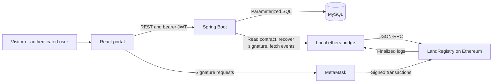

# Architecture



## What is committed

The registration service stores the PDF bytes privately in MySQL and generates a random property ID. It encodes the following immutable application fields as UTF-8 strings in this order.

```text
id, owner_name, identity_ref, initial_wallet, location, state, district,
survey, area, property_type, address, created_at
```

A four-byte big-endian length precedes each field. The normalized decimal area uses square metres and the creation time uses Unix milliseconds. After the fields comes the 32-byte SHA-256 digest of the PDF contents. SHA-256 over the entire sequence produces the contract commitment. A transfer changes the current wallet while preserving the original registration data and digest.

The administrator validates the applicant and deed before approving the application. The public verifier recomputes the digest from stored bytes and compares both digest and current owner with the contract at the indexed block. The verified-properties metric counts records whose latest completed check matched. A transfer clears the previous verification marker.

## Contract and synchronization

| Operation | Signer | Contract effect |
| --- | --- | --- |
| registerProperty | Immutable administrator | Rejects duplicate IDs, empty commitments and zero-address owners. Stores title and emits Registered. |
| initiateTransfer | Current owner | Stores one pending recipient and emits TransferInitiated. |
| reviewTransfer | Administrator | Checks the expected pending recipient. Approval appends to title history, rejection clears the proposal. Both emit events. |
| parcels / verifyOwnership | Public read | Exposes wallet and commitment or checks the specified wallet. |
| historyLength / ownershipChange | Public read | Returns historical title entries by index. |

The read adapter checks the chain, deployed code and creation block. Spring polls at ten-second intervals and can synchronize on demand. Each batch spans at most 500 blocks. The database transaction locks the cursor, stores events and changes ownership atomically. The transaction hash plus log index uniquely identifies an event. If the browser closes after broadcasting, the indexer can finish without a client callback. An unexpected registration commitment or initial owner marks the application disputed. A signed event from another contract cannot enter the configured contract’s query.

Sepolia uses finalized blocks. Local Hardhat uses its latest mined block. The wallet displays pending/mined progress separately from the indexed title. Public results distinguish a successful comparison, a mismatch, an unknown parcel, an indexing delay and a connection failure.

## Database model

The executable DDL is in [schema.sql](../backend/src/main/resources/schema.sql).

| Table | Key and purpose |
| --- | --- |
| accounts | UUID, unique email and linked wallet, bcrypt password hash, role, expiring one-use challenge |
| properties | Generated ID, applicant, initial/current wallet, private identity and deed, parcel metadata, review status and last title transaction |
| purchase_requests | Property and buyer form the key. Captures the seller wallet and the request decision. |
| chain_events | Transaction hash and log index form the key. Stores event type, wallets, block number and block timestamp. |
| verification_history | Latest property lookup and result per buyer and property |
| chain_cursor | Deployment binding and next block for resumable indexing |

## REST surface

| Method and path under /api | Access and purpose |
| --- | --- |
| POST /auth/signup, /auth/login | Public account creation and login |
| GET /public/config, /public/stats | Public deployment availability and real registry totals |
| GET /public/verify/{id}, /public/history | Public verification and paged event history |
| GET /me | Authenticated account |
| POST /wallet/challenge, /wallet/link | Time-limited signature challenge and unique wallet binding |
| POST /properties | Linked landowner, multipart JSON details and a private PDF up to 5 MB |
| GET /properties, /properties/{id} | Authorized application list and detail |
| GET /properties/{id}/document, /properties/{id}/certificate | Authorized attachment or fresh verified certificate |
| POST /properties/{id}/approve, /reject | Administrator prepares a chain registration or rejects an application with a reason |
| POST /properties/{id}/recipient | Current owner validates the linked recipient before signing |
| POST /properties/{id}/request | Buyer requests a transfer from the current owner |
| GET /requests, /views, /my-history | Role-scoped transfer requests, buyer lookups and wallet history |
| POST /chain/sync | Authenticated request to catch up from the stored cursor |

Protected endpoints read the account role from the database. Public signup grants citizen roles. The document download requires the original applicant, current owner, or administrator and returns an attachment with a server-controlled filename. The public lookup omits the identification reference, original applicant name, address and deed. Historical wallets, timestamps and commitments are public on Ethereum. The administrator’s original title review remains a trust assumption for this academic system.
